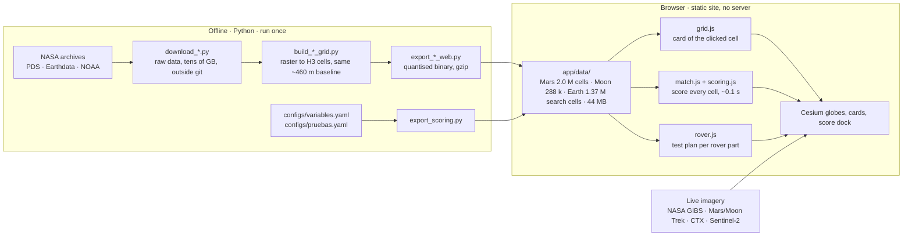
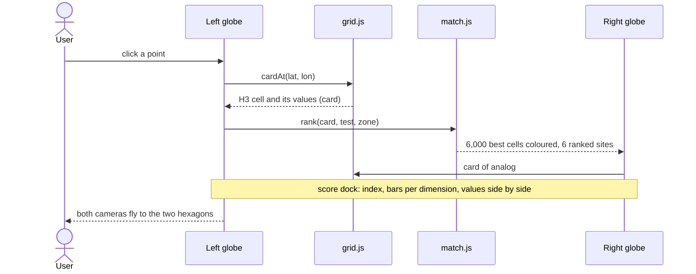

# Plan de entrega del repositorio

> Documento de trabajo del equipo. **Borrarlo antes de la entrega final** (o no subirlo a `main`).
> Escrito el 15/11/2026 de madrugada sobre el commit `ca943c9`. Todo lo que aparece como "medido" se ha
> ejecutado sobre ese commit; lo que no se ha podido comprobar está marcado **[sin comprobar]**.

## 0. Plazos y qué mira el jurado

| Hora (domingo 15) | Qué | Qué tiene que estar hecho en el repo |
|---|---|---|
| **16:00** | Primera versión de la página de equipo | Bloque A entero (sección 5): la demo no falla, el README es real y está en inglés, no queda nada que diga "datos falsos" |
| 16:30–18:30 | Pitches | Nada nuevo: no tocar `main` durante los pitches |
| **23:59** | Versión definitiva | Bloques B y C: documentación completa en inglés, limpieza, licencia |

El ganador del domingo sale del pitch, pero los premios adicionales se deciden durante la semana **leyendo la
página y el repositorio**. La página exige: descripción en inglés, enlace al repo y a la app publicada, lista de
datos y herramientas, declaración de uso de IA y referencias. El repo tiene que poder responder a esas cinco
cosas sin que nadie nos pregunte.

## 1. Resumen de la auditoría

Se ha leído todo el código de `app/src/`, los configs, los datos de `app/data/`, la documentación y las cabeceras
de `src/analogs/` y `scripts/`. Se ha ejecutado: `pytest` (19 passed), el build de producción (pasa) y el
comparador y el planificador del rover reales en Node sobre los 21 sitios objetivo.

Lo importante, en cuatro líneas:

1. **La app funciona y los datos son reales**, pero el repo dice lo contrario: el README sigue en "PROPUESTA",
   habla de datos falsos y de un pipeline "pendiente", y hay 5 MB de datos ficticios y un prototipo antiguo dentro de `app/`.
2. **El desplegable "Test" devuelve la lista vacía en 75 de 189 combinaciones** (40 %). No es solo "ruedas en
   llanuras": es un fallo general del umbral (sección 2.1).
3. **La interfaz está en inglés pero los tests y sus frases de validez salen en castellano.**
4. **Toda la documentación explicativa está en castellano** y describe el plan del sábado, no el producto.

## 2. Fallos del sistema (código)

### 2.1 Lista de resultados vacía con muchos tests — **crítico para la demo**

- **Dónde:** [app/src/match.js:320-323](app/src/match.js#L320-L323).
- **Causa:** el umbral se calcula bajando por un histograma de 0,1 en 0,1 hasta juntar 6.000 celdas. Si el
  primer tramo con datos ya tiene más de 6.000 celdas empatadas, no se queda con ninguno y el umbral cae por
  encima de todas (`100.05`, `69.15`…). Pasa siempre que el test usa pocas variables o variables por clases
  (hielo), porque miles de celdas sacan exactamente la misma nota.
- **Medido** (21 sitios × 9 opciones del desplegable):

  | Opción del desplegable | Sitios con lista vacía (de 21) |
  |---|---|
  | All shared variables | 0 |
  | Perforación | 20 |
  | Hábitat | 16 |
  | Ruedas | 13 |
  | Comunicaciones | 13 |
  | Navegación | 7 |
  | Hielo | 3 |
  | Polvo | 2 |
  | Energía y térmica | 1 |

  **Jezero:** fallan Perforación y Hábitat; el resto devuelve resultados. **Shackleton:** fallan Perforación,
  Hielo, Energía y Hábitat.
- **Arreglo propuesto** (no aplicado todavía):
  1. Si no se ha guardado ninguna celda (`kept === 0`), incluir el tramo que desborda (`bin--`).
  2. Limitar `top` a 6.000 celdas después de ordenar. Sin este límite se pintarían cientos de miles de
     hexágonos y Cesium se queda colgado.
  3. Desempatar las celdas con la misma nota usando el índice general ("all shared variables"), para que el
     nº 1 tenga sentido.
- **Comprobación:** repetir la tabla de arriba; tiene que quedar a 0 salvo los tests sin ninguna variable.

### 2.2 Empates: el nº 1 es arbitrario — **alto**

- Con el test Ruedas, el mejor análogo de Jezero sale en **89,4° S (Polo Sur)** con 100/100: hay miles de
  celdas con la misma pendiente y rugosidad, y gana la primera por orden interno. El punto 3 del arreglo anterior lo resuelve.
- Los candidatos son solo las 3.000 primeras celdas ([match.js:329](app/src/match.js#L329)). Cuando están todas
  en la misma región, la separación de 400 km deja **un solo resultado** (pasa con Polvo en 7 sitios de Marte).
  Arreglo: tomar los candidatos repartidos por toda la lista `top`, no los primeros.

### 2.3 Tests que prometen más de lo que comparan — **alto (validez)**

Tres tests usan variables que no existen en la tabla de la Tierra, y la app no lo dice con claridad:

| Test | Variables en `configs/pruebas.yaml` | Lo que se compara de verdad |
|---|---|---|
| Ruedas | pendiente, rugosidad, **rocas** | pendiente y rugosidad |
| Perforación | **litología**, hielo | solo hielo |
| Hábitat | temperatura media, **cuevas** | solo temperatura media |
| Polvo, desde la Luna | polvo | la Luna no tiene polvo: usa todas las variables y da lo mismo que "All shared variables" |

Opciones, de menos a más trabajo: (a) quitar Perforación y Hábitat del desplegable; (b) dejarlos y añadir al
nombre "(partial: ice only)"; (c) mostrar en la barra de resultados qué variables se han usado y cuáles faltan.
**Recomendación: (a) para las 16:00 y (c) si sobra tiempo.**

### 2.4 Castellano dentro de la interfaz en inglés — **alto (se ve en la demo)**

`app/data/tierra/match.json` se genera desde `configs/variables.yaml` y `configs/pruebas.yaml`, que están en
castellano. Salen en pantalla: los nombres de los tests ("Ruedas / movilidad"), la frase "Validity: …" y los
nombres de variable en los tooltips del panel de puntuación.

- **Arreglo:** traducir `label`, `test_validity` y `criterion` en los dos YAML y ejecutar
  `.venv\Scripts\python.exe scripts\export_scoring.py`. No hay que tocar código ni regenerar la malla.

### 2.5 Fallos menores

| # | Dónde | Qué pasa | Arreglo |
|---|---|---|---|
| 1 | [app/src/zones.js:55](app/src/zones.js#L55) | La zona lunar "Mid latitudes (30–80°)" solo cubre el hemisferio sur (−80 a −30) | Renombrar a "Southern mid latitudes" o añadir la del norte |
| 2 | [app/src/card.js:214](app/src/card.js#L214) | El panel dice "20 km around" en los tres cuerpos; es cierto en la Tierra (~6,5 km por celda), no en Marte (~9 km) ni en la Luna (~12 km) | Calcularlo con `cellSizeKm` del cuerpo |
| 3 | [app/src/data.js:13](app/src/data.js#L13) | Los sitios objetivo se leen de `app/data/objetivos.json`, que lleva `"_aviso": "DATOS FALSOS"`. Solo se usan nombre y coordenadas (los valores reales salen de la malla), pero el fichero es el ficticio | Leer `marte/objetivos.json` + `luna/objetivos.json` y borrar el ficticio |
| 4 | [app/src/data.js:19](app/src/data.js#L19) | El indicador `mock` se calcula y no se usa en ningún sitio | Borrarlo con el punto 3 |
| 5 | `app/src/main.js`, `card.js`, `rover.js` | Las tablas `ENV`, `NAME` y las clases de hielo están copiadas en tres ficheros | Dejar una sola copia (bloque C) |
| 6 | [app/src/main.js:669-682](app/src/main.js#L669-L682) | Variables globales de depuración (`window.Cesium`, `window.rover`…) | Inofensivo; dejarlo con su comentario |
| 7 | `app/src/rover.js` | En Marte, "Thermal" declara `t_min_K`, que Marte no tiene, y se salta sin avisar. En Chandrayaan-3 el taladro queda "no data" y el índice baja a 25 % | Documentarlo en la metodología |

### 2.6 Lo que sí se ha comprobado que funciona

- `python -m pytest`: **19 passed**.
- `npm run build`: pasa (dist de 58 MB, casi todo Cesium y `data/`).
- Planificador del rover, ejecutado con el código real: **Jezero 70 %**, **Shackleton 30 %**, los nueve sitios
  lunares entre 25 y 30 %, los de Marte entre 60 y 70 %. Coincide con lo que dice `app/README.md`.
- Buscador con "All shared variables": devuelve resultados en los 21 sitios, en 0,1–0,16 s por búsqueda sobre
  1.374.390 celdas.

### 2.7 Sin comprobar

- **Que GitHub Pages esté activado y la app publicada funcione.** La tarea 0.8 del ROADMAP sigue sin marcar y
  no he podido consultar GitHub desde aquí. Lo tiene que mirar Marc (dueño del repo): *Settings → Pages →
  Source: GitHub Actions*, última ejecución del workflow en verde y la URL pública abierta en una ventana privada.
- **Que el repo sea público.**
- La app en el navegador: todo lo anterior sale de ejecutar el código en Node y de leerlo, no de usar la web.

## 3. Incoherencias del repositorio

### 3.1 Textos que contradicen el estado real

| Fichero | Dice | Realidad |
|---|---|---|
| `README.md` | "Estado: PROPUESTA", "datos falsos", "el pipeline se para en el paso 1", "8 passed", tabla de equipo vacía | Producto funcionando con datos reales; 19 tests; cuatro autores en git |
| `README.md`, `data/README.md`, `src/analogs/__init__.py` | Flujo `download → ingest → features → export` con `fichas_tierra.parquet` | `ingest.py`, `features.py` y `validate.py` son esqueletos; el flujo real es `download_*` → `build_*_grid.py` → `export_*_web.py` |
| `app/README.md` | Fórmula lineal `max(0, 1 − Δ/tol)` "idéntica a similarity.py"; tabla "opciones de librería, decidir el sábado" | Nota suave `1/(1+(Δ/half_diff)²)` por dimensiones; Cesium ya elegido |
| `docs/03_enfoque.md` §2.1 y decisión 003 | "Se eligió la nota lineal" | Se cambió a la suave (`docs/09`) |
| `docs/decisions/README.md` | Decisiones 002, 003, 004 y 007 siguen como "PROPUESTA, a confirmar" | Están aplicadas |
| `ROADMAP.md` | "29 / 62 tasks done"; 3.8–3.12 (Tierra) y 4.1–4.9 sin marcar; Tierra en H3 res 4 con Copernicus DEM | La Tierra está hecha en H3 res 6 con ETOPO 2022; la integración está hecha |
| `scripts/README.md` | `run_pipeline.py` "pendiente", `build_moon_features.py` "por hacer"; faltan 8 scripts en la lista | Existen `build_moon_grid.py`, `build_earth_grid.py`, `export_*_web.py`, `export_scoring.py`, `check_grid_binary.py`… |
| `docs/08_datos_LEEME.md` §0 | "La Luna y Marte están descargadas pero falta convertirlas en fichas" | Hechas y exportadas |
| `data/README.md` | 30 sitios objetivo | La app enseña 21 (faltan coordenadas de las 9 regiones lunares) |
| `README.md` | "Una rama por tarea → Pull Request" | Todo está en `main` con commits directos |

### 3.2 Restos que confunden a quien abre el repo

| Qué | Por qué sobra | Qué hacer |
|---|---|---|
| `app/comparador.html`, `app/app.js`, `app/comparator.js`, `app/demo-data.js`, `app/COMPARADOR.md` | Prototipo antiguo "Luna → Tierra" con datos ficticios. `app/app.js` **no** es la app, y lo parece | Borrar o mover a `legacy/` (decisión 4 de la sección 6) |
| `app/repository-data.js` y `.json` (2,5 MB cada uno) | Datos ficticios del prototipo | Igual que el anterior |
| `app/data/config.json`, `app/data/tierra.json` | Ficticios; la app no los lee | Borrar |
| `scripts/make_mock_data.py`, `scripts/build_comparator_data.py`, `tests/test_comparator_integration.py` | Solo sirven al prototipo; el test depende de los ficheros ficticios | Van con el prototipo (borrar los tres juntos o `pytest` falla) |
| `scripts/run_pipeline.py`, `src/analogs/ingest.py`, `features.py`, `validate.py` | Esqueletos que lanzan `NotImplementedError` | Borrar, y actualizar `__init__.py` |
| `src/analogs/mars.py` + `scripts/build_mars_features.py` | Borrador previo a `mars_grid.py` | Borrar si `mars_grid.py` no importa nada de `mars.py` (comprobar antes) |
| `app/.vite/deps/` | Caché de Vite subida a git | `git rm -r --cached` y añadir `.vite/` al `.gitignore` |
| `.claude/launch.json` | Está en el `.gitignore` pero sigue en git | `git rm --cached` |
| `dades_mart.pdf` en la raíz | Notas de trabajo en catalán | Mover a `docs/archive/` |
| `notebooks/`, `presentation/`, `outputs/figures/` | Carpetas vacías con solo un README | Borrar las vacías; `presentation/` se queda si se suben las diapositivas |
| `docs/04_plan_sabado.md`, `05_equipo_y_roles.md`, `meetings/brainstorming.md`, `referencia/brief_inicial.md` | Plantillas sin rellenar y plan del sábado | Mover a `docs/archive/` |
| `outputs/validation/busqueda_*.csv` | Salidas sueltas de una búsqueda del día 14 | Mover a `docs/archive/` o borrar |

### 3.3 Idiomas mezclados

- **Documentación:** castellano en `README`, `docs/01–06`, `08`, `09`, `scripts/README`, `data/README`; inglés en
  `ROADMAP` y `docs/07`; un PDF en catalán.
- **Código:** comentarios en inglés en `app/src/` y en `mars_grid.py`, `moon.py`; en castellano en `earth*.py`,
  `similarity.py`, `export.py`, `paths.py`, los YAML y los tests.
- **Identificadores:** carpetas `marte/`, `luna/`, `tierra/`; claves `pruebas`, `objetivos`, `analogos_conocidos`, `_aviso`.

**Recomendación:** traducir toda la documentación y los textos que salen en pantalla. **No renombrar carpetas
ni claves de datos**: tocan `match.js`, `grid.js`, `main.js`, `export.py` y los 366 ficheros binarios, y un
error rompe la demo. Se explica con un glosario de seis líneas en la documentación de arquitectura.

### 3.4 Faltan

- **Licencia.** Sin `LICENSE` el código no es legalmente reutilizable, y Space Apps pide proyecto abierto.
- **Declaración de uso de IA** (obligatoria en la página de equipo). `docs/08` contiene un prompt para Claude y
  `.claude/` está en el repo: se ve que se ha usado, mejor decirlo nosotros.
- **Créditos de terceros:** modelo de Perseverance (NASA/JPL-Caltech), Sentinel-2 cloudless (EOX, **CC BY 4.0,
  exige atribución**), Natural Earth, mosaico CTX (Caltech Murray Lab/Esri), CesiumJS, three.js, H3.
- **Pruebas del código JavaScript.** La fórmula está duplicada en Python y en JS y nada comprueba que coincidan.
- **Capturas de pantalla o GIF** de la app.

## 4. Cómo tiene que quedar el repositorio

```
SpaceAppsNASA/
├── README.md                  inglés: qué es, demo, cómo se usa, cómo funciona, datos, límites, equipo
├── LICENSE
├── app/                       la web (Vite + CesiumJS + three.js)
│   ├── README.md              corto: arrancar, compilar, estructura de src/ y de data/
│   ├── index.html, src/, data/
│   └── tests/smoke.mjs        el comparador en Node sobre los 21 sitios (opcional, bloque C)
├── src/analogs/               Python: de los datos de NASA a las mallas
├── scripts/                   lo que se ejecuta, con README actualizado
├── configs/                   variables.yaml y pruebas.yaml (textos en inglés)
├── data/catalogs/             sitios objetivo y análogos conocidos
├── tests/
└── docs/
    ├── USER_GUIDE.md          la interfaz, con capturas
    ├── ARCHITECTURE.md        esquemas del sistema y glosario
    ├── METHODOLOGY.md         la fórmula, los criterios y el planificador del rover
    ├── LIMITATIONS.md         qué no mide y qué no está validado
    ├── DATA_SOURCES.md        cada dato: misión, producto, resolución, enlace, licencia
    ├── DATA_FORMAT.md         el actual docs/07 (ya está en inglés)
    ├── CODE_REFERENCE.md      qué hace cada módulo y cada función
    ├── DEVELOPMENT.md         instalar, regenerar datos, tests, despliegue
    ├── AI_USAGE.md            dónde y cómo se ha usado IA
    ├── img/                   capturas y GIF
    └── archive/               los documentos de trabajo en castellano, con una nota de una línea
```

### 4.1 README.md (inglés, que se lea en dos minutos)

1. Nombre, una frase y **GIF de la app** (Jezero → análogo → cambio de test).
2. **Try it:** enlace a la app publicada y tres pasos para usarla.
3. **What it does:** buscador de análogos y planificador de ensayos del rover, dos párrafos y dos capturas.
4. **How it works:** el esquema de la sección 4.3 y cuatro cifras (2,0 M celdas en Marte, 288 k en la Luna,
   1,37 M de búsqueda en la Tierra, ~0,1 s por búsqueda en el navegador).
5. **The index in three steps:** nota por variable, media por dimensión, zona de 7 celdas. Enlace a METHODOLOGY.
6. **NASA data used:** tabla corta (MOLA, TES, MCS, GRS, SWIM, LOLA, Diviner, Lunar Prospector, MODIS, GPM,
   MERRA-2, ETOPO, ECOSTRESS). Enlace a DATA_SOURCES.
7. **What Earth cannot reproduce / limitations:** cinco líneas honestas. Enlace a LIMITATIONS.
8. **Run it locally:** `cd app`, `npm install`, `npm run dev`.
9. **Repository map:** el árbol de arriba con una línea por carpeta.
10. **Team**, **AI usage** (enlace), **Credits and licence**.

### 4.2 Qué contiene cada documento

| Documento | Contenido | De dónde sale |
|---|---|---|
| `USER_GUIDE.md` | Barra superior control a control (cuerpos, ⇄, Relief, Test, búsqueda, Zone); clic → ficha → resultados → panel de puntuación; cómo leer el índice y las barras por dimensión; dibujar una zona; vista del rover (piezas, colores, campaña); teclas (Esc); `#rover` en la URL | `index.html`, `main.js`, `card.js`, `places.js`, `rover.js` |
| `ARCHITECTURE.md` | Esquema del pipeline, esquema de la app en ejecución, secuencia de un clic, mapa de módulos, glosario castellano → inglés (marte, luna, tierra, pruebas, objetivos, fichas) | Sección 4.3 |
| `METHODOLOGY.md` | Fórmula con un ejemplo numérico; tabla de `half_diff` con su criterio; matriz del hielo; dimensiones y pesos; índice de zona; qué variables se comparan entre cada par de cuerpos; método ráster → celda H3; máscara de búsqueda de la Tierra; método del rover (caja de márgenes, estados, límites físicos, índice, campaña) | `docs/09`, `configs/*.yaml`, `scoring.js`, `rover.js`, `rover.json`, ROADMAP 3.5 |
| `LIMITATIONS.md` | Gravedad, presión, radiación; sin geología ni química; resolución de 6–12 km; temperaturas de Marte fuera del rango terrestre; tolerancias y márgenes son supuestos nuestros; "field" en el rover = existe al menos una celda; validación con análogos conocidos pendiente y cómo se haría | `docs/09` punto 9, `docs/03` §2 |
| `DATA_SOURCES.md` | Una fila por dataset: cuerpo, misión e instrumento, producto, resolución, periodo, variable que alimenta, URL, licencia o cita. Aparte: teselas de imagen en vivo y modelo 3D | `variables.yaml` (`sources`), `catalog.py`, `bodies.js`, `data/raw/*/MANIFEST.csv` |
| `CODE_REFERENCE.md` | Por módulo: para qué sirve, funciones exportadas con entrada y salida, quién las llama. JS: 14 ficheros de `app/src/`. Python: 16 módulos de `src/analogs/`. Scripts: una línea cada uno | Los comentarios del código ya dan casi todo |
| `DEVELOPMENT.md` | Requisitos; arrancar la web; entorno Python; carpeta de datos fuera del repo; orden para regenerar cada malla; `export_scoring.py` tras tocar un YAML; tests; despliegue en Pages | `scripts/README.md`, `docs/08`, workflow |
| `AI_USAGE.md` | Qué herramienta, para qué (código, documentación, revisión), qué revisó el equipo, qué **no** es IA (datos, criterios, decisiones) | Lo redacta el equipo; no inventar |

### 4.3 Esquemas (borradores en Mermaid; GitHub los dibuja solo)

**Sistema completo** (para README y ARCHITECTURE):



**Un clic, paso a paso** (para ARCHITECTURE y USER_GUIDE):



**Mapa de módulos de `app/src/`** (para CODE_REFERENCE): `main.js` en el centro; `globe.js` ← `bodies.js`,
`coords.js`; `grid.js`; `match.js` ← `scoring.js`, `zones.js`; `card.js`; `places.js`; `countries.js`;
`rover.js` → `rover3d.js` (se carga solo al abrir esa vista).

## 5. Orden de ejecución

### Bloque A — antes de las 16:00 (unas 3 h)

| # | Tarea | Tiempo | Riesgo |
|---|---|---|---|
| A1 | Arreglar el umbral y los empates (2.1 y 2.2) y repetir la prueba de los 21 sitios | 45 min | Medio: toca el ranking. Probar Jezero y Shackleton en el navegador después |
| A2 | Traducir `label` y `test_validity` de los YAML y ejecutar `export_scoring.py` (2.4) | 20 min | Bajo |
| A3 | Quitar o marcar los tests incompletos (2.3) | 10 min | Bajo |
| A4 | Leer los sitios de `marte/` y `luna/objetivos.json`; borrar `config.json`, `tierra.json` y `objetivos.json` ficticios (2.5, puntos 3 y 4). Si el prototipo antiguo sigue en el repo, sus tests dejan de pasar: hacerlo junto con B1 o dejar los ficheros hasta entonces | 20 min | Medio |
| A5 | Marc: comprobar Pages, repo público y URL de la app (2.7) | 10 min | — |
| A6 | Capturas y GIF de la app | 20 min | — |
| A7 | `README.md` nuevo en inglés (4.1) | 45 min | — |
| A8 | `LICENSE` y `docs/AI_USAGE.md` | 15 min | Necesita las decisiones 3 y 5 |
| A9 | `npm run build`, `pytest`, abrir la app publicada y hacer el recorrido de la demo | 15 min | — |

Si A1 no sale limpio a la primera, **no arriesgar**: dejar en el desplegable solo las opciones que funcionan en
los sitios de la demo y arreglar el umbral por la noche.

### Bloque B — de 18:30 a 23:59, documentación

| # | Tarea | Tiempo |
|---|---|---|
| B1 | Limpieza de la sección 3.2 en un solo commit, con `pytest` y build después | 30 min |
| B2 | `docs/archive/` con los documentos en castellano y una nota de una línea | 10 min |
| B3 | `METHODOLOGY.md` y `LIMITATIONS.md` | 60 min |
| B4 | `ARCHITECTURE.md` con los esquemas | 40 min |
| B5 | `USER_GUIDE.md` con capturas | 40 min |
| B6 | `DATA_SOURCES.md` | 40 min |
| B7 | `CODE_REFERENCE.md` | 60 min |
| B8 | `DEVELOPMENT.md`, `app/README.md` y `scripts/README.md` en inglés | 30 min |
| B9 | Poner al día `ROADMAP.md` (marcar lo hecho, quitar lo obsoleto) o moverlo al archivo | 15 min |

### Bloque C — si sobra tiempo

- 2.5, puntos 1, 2 y 5.
- `app/tests/smoke.mjs` (el comparador en Node sobre los 21 sitios) y un paso de tests en el workflow antes de desplegar.
- Traducir los comentarios en castellano de `similarity.py` y `earth_grid.py`.
- Descripción, temas y enlace a la app en la cabecera del repo de GitHub.
- `scripts/validate_analogs.py` (punto 9 de `docs/09`): no cabe hoy; dejarlo descrito en LIMITATIONS.

## 6. Decisiones del equipo (antes de empezar)

| # | Decisión | Recomendación |
|---|---|---|
| 1 | Nombre del proyecto (el repo dice "Earth Analogs", la app "Analogs", el paquete `spaceapps-analogs-app`) | Uno solo, en el README, en `<title>` y en la página de equipo |
| 2 | Nombres y papel de cada miembro para el README | Los cuatro autores de git, con el papel real |
| 3 | Licencia | MIT para el código; indicar aparte que los datos derivan de productos públicos de NASA/NOAA y que Sentinel-2 cloudless es CC BY 4.0 |
| 4 | Prototipo antiguo del comparador | Borrarlo (sigue en el historial de git). Preguntar antes a Miquel, que lo escribió |
| 5 | Qué se declara sobre el uso de IA | Lo redacta el equipo con lo que ocurrió de verdad |
| 6 | Mensajes de commit poco serios en el historial ("LET'S F… GO", ".") | No reescribir el historial: es arriesgado a horas de la entrega y cambia los identificadores que ya tienen los demás. Cuidar los commits desde ahora |
| 7 | Documentos de trabajo en castellano | Archivarlos, no borrarlos: enseñan el proceso y las decisiones |

## 7. Lista final antes de las 23:59

- [ ] La app publicada abre en una ventana privada, y Jezero y Shackleton devuelven resultados con todos los tests visibles.
- [ ] `grep -ri "DATOS FALSOS\|PROPUESTA\|mock"` no encuentra nada fuera de `docs/archive/`.
- [ ] README en inglés con GIF, enlace a la app, datos de NASA, límites, equipo, IA y licencia.
- [ ] `python -m pytest` y `npm run build` pasan en un clon limpio.
- [ ] `LICENSE`, `docs/AI_USAGE.md` y créditos de terceros presentes.
- [ ] Ningún texto en castellano en la interfaz.
- [ ] La página de equipo enlaza al repo y a la app, y su texto coincide con el README (mismas cifras).
- [ ] Este fichero, borrado.

## 8. Cifras que se pueden citar (medidas sobre `ca943c9`)

| Dato | Valor |
|---|---|
| Celdas de Marte (H3 res 5, ~9,1 km) | 2.016.842 |
| Celdas de la Luna (H3 res 4, ~12,3 km) | 288.122 |
| Celdas de la Tierra, malla completa (H3 res 6, ~6,5 km) | 14.117.882 |
| Celdas de búsqueda de la Tierra (desierto, hielo polar, árido abierto) | 1.374.390 |
| Tiempo de una búsqueda sobre la Tierra (Node, este portátil) | 0,10–0,16 s |
| Tamaño de `app/data/` | 44 MB |
| Tests de Python | 19 |
| Ensayabilidad del rover | Jezero 70 % · Shackleton 30 % |

No citar como "validado": la validación con análogos conocidos no está hecha.
