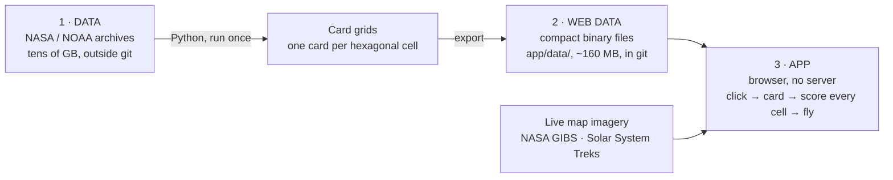

# 🌍🌕🔴 Earth Analogs for Moon & Mars — NASA Space Apps 2026

**Click any point of Mars or the Moon and find the places on Earth that physically resemble it**, with
the reasons: every variable, its value on both sides and where each number comes from.

**Challenge:** *Identify Earth Locations that Analog the Permanent Moon Base Locations and Mars*
([full statement](docs/02_reto_oficial.md)).

**Contents:** [What it does](#what-it-does) · [Quick start](#quick-start) · [How it works](#how-it-works) ·
[The analog index](#the-analog-index-in-three-steps) · [Data](#data) · [Limits](#what-it-does-not-do) ·
[Run it, step by step](#run-it-on-your-computer-step-by-step) · [Regenerating the data](#regenerating-the-data-python) ·
[Repository map](#repository-map) · [Documentation](#documentation) · [Team](#team) ·
[Licence and credits](#licence-and-credits)

## What it does

A web app with 3D globes of Mars, the Moon and Earth, with three views:

| View | What you do | What you get |
|---|---|---|
| **Analogs** | Click any point of one body (any body against any other) | The other globe painted by similarity, the six best sites, a **card** with every variable on both sides and its source, and an **analog index from 0 to 100** broken down by dimension (terrain, thermal, water & ice, sky & light) |
| **Rover test planner** | Send a rover to a Mars or Moon cell | For each part of the rover (wheels, cameras, drill, thermal control, dust): whether it can be field-tested on Earth, where, and what physics prevents (gravity, vacuum) |
| **Route replica** | Draw a route on Mars or the Moon, or load a real rover traverse | A path on Earth with the same slopes in the same order |

You choose **what you want to test** (wheels, navigation, ice detection, solar power, dust…): the same
place can be a good analog for one test and a poor one for another. The search can be limited to a zone
of Earth.

## Quick start

Needs [Git](https://git-scm.com/downloads) and [Node.js 20 or newer](https://nodejs.org). No account, no
server, no Python.

```bash
git clone https://github.com/pablourioste/SpaceAppsNASA.git
cd SpaceAppsNASA/app
npm install
npm run dev
```

Open <http://localhost:5173>, press Enter and click any point of Mars.
Detailed instructions and troubleshooting: [below](#run-it-on-your-computer-step-by-step).

## How it works



- Each body is covered by **hexagonal cells** ([H3](https://h3geo.org)) and each cell has a **card**:
  slope, roughness, temperatures, water ice, dust, Sun elevation… computed from NASA mission data.
- The comparison is fair because it is made **at the same scale on every body**: slope and roughness
  come from ~460 m elevation pixels on all three, aggregated to cells of 6–12 km.
- The cards are computed once and stored as small compressed files. All the matching happens **in the
  browser** (~0.1–0.6 s per search). The only live requests are the map imagery.

| Body | Cells | Cell size | Main data |
|---|---|---|---|
| Mars | 2,016,842 | ~9.1 km | MGS MOLA and TES, Odyssey GRS, MRO MCS, SWIM 2.0, NASA Ames Mars GCM |
| Moon | 288,122 | ~12.3 km | LRO LOLA and Diviner, Lunar Prospector, NASA PGDA |
| Earth | 14,117,882, of which 1,374,390 searched (deserts, polar ice, arid open land) | ~6.5 km | NOAA ETOPO 2022, MODIS, GPM IMERG, MERRA-2, ECOSTRESS |

More: [`docs/ARCHITECTURE.md`](docs/ARCHITECTURE.md).

## The analog index in three steps

Values are compared **in physical units** (K, degrees, metres), not as percentiles within each body.

1. **A note per variable**, from 0 to 1: `1 / (1 + (difference / half_diff)²)`. It is 1 when both
   values are equal, 0.5 when they differ by the tolerance `half_diff`, and never 0, so places are still
   ranked when Earth cannot reach the target value (the cold of Mars).
2. **A note per dimension**: the weighted mean of its variables, so three temperatures count once.
3. **The index**: 100 × the weighted mean of the dimensions, with the weights of the chosen test.

The ranking then mixes each cell with its 6 neighbours (60 % / 40 %) to put homogeneous areas first,
and spreads the results over the globe. Only variables with data on both sides are compared, and the app
says how many. Every tolerance has a written reason in [`configs/variables.yaml`](configs/variables.yaml).

Formulas, derivation of each variable and a worked example: [`docs/METHODOLOGY.md`](docs/METHODOLOGY.md).

## Data

All data are public measurements or published models from NASA, NOAA and USGS archives (PDS, Earthdata,
NCEI, NASA Ames). Nothing is AI-generated.

- Every dataset with its mission, resolution, period, download location and reference:
  [`docs/DATA_SOURCES.md`](docs/DATA_SOURCES.md).
- Every downloaded file with its URL: `data/raw/<body>/MANIFEST.csv`.
- Licences and required credits (imagery, 3D model, libraries): [`CREDITS.md`](CREDITS.md).

On Mars the card also shows the slope at the clicked point (~0.9 km pixel), the solar energy on a
horizontal panel (NASA Appelbaum & Flood model) and the mean wind and wind stress (NASA Ames Mars GCM).

## What it does not do

- **Earth cannot reproduce** the gravity, the pressure, the day length or the radiation of the Moon and
  Mars. These are shown with each test, never hidden inside the index.
- **Geology is not compared yet**: two cells can match in terrain and climate and be different rocks.
- **The scale is 6–12 km**: what is smaller than a cell is averaged out.
- **Tolerances and weights are the team's assumptions**, each with a written reason; they are not
  calibrated, and the validation against known analogs is designed but not done.
- **The index is not a probability**: it orders places for one target and one test.

In full: [`docs/LIMITATIONS.md`](docs/LIMITATIONS.md).

## Run it on your computer, step by step

The app runs **locally**: nothing to deploy and no account needed. Everything it needs is in this
repository (~170 MB with the data); only the map imagery is loaded from the internet while you use it.

**1. Install two programs** (once):

| Program | Where | Check it in a terminal |
|---|---|---|
| **Git** | [git-scm.com/downloads](https://git-scm.com/downloads) | `git --version` |
| **Node.js 20 or newer** (LTS) | [nodejs.org](https://nodejs.org) | `node --version` |

Default options in both installers are fine. On Windows, open a **new** terminal (PowerShell) after
installing so the commands are found.

**2. Download the project:**

```bash
git clone https://github.com/pablourioste/SpaceAppsNASA.git
```

```bash
cd SpaceAppsNASA/app
```

(No Git? On the GitHub page: **Code → Download ZIP**, unzip it, and open a terminal in the `app` folder.)

**3. Install the app's libraries** (once, ~1 minute):

```bash
npm install
```

**4. Start it:**

```bash
npm run dev
```

**5. Open [http://localhost:5173](http://localhost:5173)** in Chrome, Edge or Firefox. Press Enter on the
opening screen, pick the body to click on (Mars, Moon or Earth) and the body to search, and click any
point: the other globe is painted with its analogs. `Esc` clears the selection. The title menu (top
left) opens the **Rover test planner** and the **Route replica**.

To stop it: `Ctrl + C` in the terminal. Next time, only steps 4 and 5.

**If something goes wrong:**

| Problem | Fix |
|---|---|
| `npm` or `node` "not recognized" | Close the terminal and open a new one; if it persists, reinstall Node.js |
| A red error about a missing import (`d3-geo`, `three`…) | Run `npm install` again (do it after every `git pull`) |
| Port 5173 is busy | The terminal shows the address it used instead (5174, 5175…) |
| The globes stay black | It needs an internet connection for the imagery; reload the page |

Python is **not** needed to run the app, only to rebuild the data (next section).

## Regenerating the data (Python)

```bash
python -m venv .venv
.venv\Scripts\activate             # Windows   (Linux/Mac: source .venv/bin/activate)
pip install -r requirements.txt    # SSL errors: add --use-feature=truststore
python -m pytest                   # 13 passed
```

Raw data stay **outside git** (tens of GB): by default in `C:\Users\<you>\SpaceAppsData` (`raw/`,
`interim/`, `processed/`), or wherever `ANALOGS_DATA_DIR` points. The pipeline, per body:

| Step | Mars | Moon | Earth |
|---|---|---|---|
| 1. Download | `scripts/download_data.py` | `scripts/download_moon.py` | `scripts/download_earth.py` |
| 2. Card grid | `scripts/build_mars_grid.py` (~18 min) | `scripts/build_moon_grid.py` | `scripts/build_earth_mask.py` + `scripts/build_earth_grid.py` |
| 3. Web export | `scripts/export_mars_web.py`, `scripts/export_mars_slope_tiles.py` | `scripts/export_moon_web.py` | (written by `build_earth_grid.py`) |

After changing a tolerance, a weight or a test in `configs/`, run `python scripts/export_scoring.py` and
reload the page. Check any export with `scripts/check_grid_binary.py`. The app's own tests: `npm test`
in `app/`.

Guides: [`scripts/README.md`](scripts/README.md) (every script),
[`docs/08_datos_LEEME.md`](docs/08_datos_LEEME.md) (the data folder and the processing order),
[`docs/07_card_grid_binary_format.md`](docs/07_card_grid_binary_format.md) (the web data format).

## Repository map

```
SpaceAppsNASA/
├── README.md                ← you are here
├── ROADMAP.md               task list, with what was done and how it was checked
├── CREDITS.md, LICENSE      data / imagery / library credits and the code licence
├── app/                     THE APP (Vite + CesiumJS + three.js)
│   ├── src/                 globes, cards, scoring, search, rover planner, route replica
│   └── data/                what the app reads: marte/, luna/, tierra/ card grids, scoring settings,
│                            Mars slope tiles, rover config and 3D model
├── configs/                 WHAT IS COMPARED
│   ├── variables.yaml       variables, units, tolerances (half_diff) with their criterion, sources
│   └── pruebas.yaml         "what do you want to test?" = the weights of each test
├── src/analogs/             Python: from NASA data to the card grids (one module per body + export)
├── scripts/                 what is run (download, build, export, check)
├── data/catalogs/           target sites (Moon / Mars) and known Earth analogs   [in git]
├── docs/                    documentation (index: docs/README.md)
├── presentation/            where to find the pitch slides (attached to a GitHub release)
├── outputs/                 figures, quick-look maps and validation outputs
└── tests/                   tests: Python (pytest) and JavaScript (npm test, from app/)
```

Folder and key names in Spanish are kept on purpose (renaming them would touch the data files):
`marte` = Mars, `luna` = Moon, `tierra` = Earth, `pruebas` = tests, `objetivos` = target sites,
`analogos_conocidos` = known analogs, `fichas` = cards.

## Documentation

| Document | What it explains |
|---|---|
| [`docs/README.md`](docs/README.md) | Index of all the documents, in reading order |
| [`docs/ARCHITECTURE.md`](docs/ARCHITECTURE.md) | How the repository works: the three stages, what happens on a click, module map, glossary |
| [`docs/METHODOLOGY.md`](docs/METHODOLOGY.md) | The mathematics: grid, how each variable is computed, the index, the ranking, rover planner, route replica |
| [`docs/DATA_SOURCES.md`](docs/DATA_SOURCES.md) | Every dataset, where it comes from and how to cite it |
| [`docs/CODE_REFERENCE.md`](docs/CODE_REFERENCE.md) | Every module, script and configuration file |
| [`docs/LIMITATIONS.md`](docs/LIMITATIONS.md) | What is not measured, not reproducible on Earth or not validated |
| [`docs/07_card_grid_binary_format.md`](docs/07_card_grid_binary_format.md) | Format of the files the app reads |
| [`docs/decisions/README.md`](docs/decisions/README.md) | Decision log |
| [`docs/NEXT_STEPS.md`](docs/NEXT_STEPS.md) | What we would do next |

## How we work

- Heavy data **outside git** (shared team drive, zips made with `scripts/pack_data.py`). In git: code,
  configs, catalogues and the web data.
- Important decisions in [`docs/decisions/`](docs/decisions/README.md).
- **[verify]** = not checked yet · **[assumption]** = a value chosen by us, to be reviewed (all tolerances
  and test weights are assumptions with a written criterion).

## Team

| Role | Person |
|---|---|
| Coordination and presentation | |
| Science and validation | |
| Moon and Mars data | |
| Earth data | |
| Engine | |
| App | |

## Pitch

The 7-slide pitch (PowerPoint, 127 MB) is attached to the GitHub release `pitch`:
[download `Earth_Analog_Presentation.pptx`](https://github.com/pablourioste/SpaceAppsNASA/releases/download/pitch/Earth_Analog_Presentation.pptx).

## Next steps

**Use Mars' Earth twins to learn when a rover's "no traces of past life found" really means something,
and when it only means our instruments can't see well enough.** How we would do it, and the next
parameters to add (radiation at the surface): [`docs/NEXT_STEPS.md`](docs/NEXT_STEPS.md).

## Use of AI

We used Claude (Anthropic), mostly through Claude Code, to help write and debug the code, process the
data and draft the documentation; the team chose the method, made the decisions and checked every
result. No data or images are AI-generated. Details: [`docs/AI_USAGE.md`](docs/AI_USAGE.md).

## Licence and credits

Code: [MIT](LICENSE). Data, imagery, the 3D model and the libraries keep their own licences and credits:
see [`CREDITS.md`](CREDITS.md). The Sentinel-2 cloudless imagery (EOX) is CC BY 4.0 and must be credited.
This project uses public NASA data but is not endorsed by NASA.
