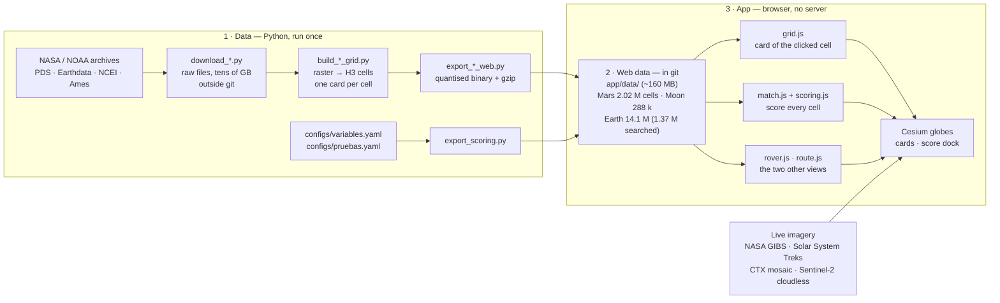
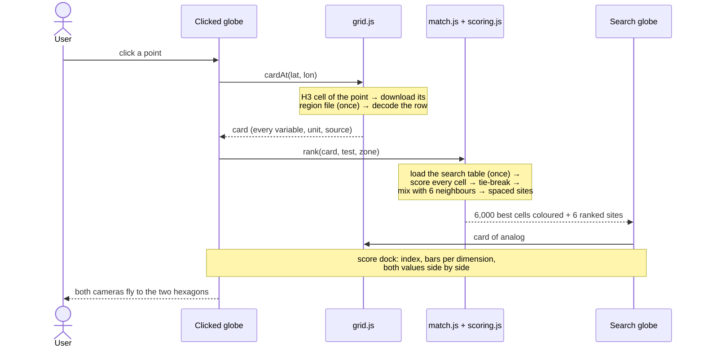
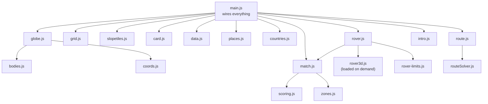

# Architecture: how the repository works

The project has three stages. The first two run once, on one computer, in Python. The third is the web
app, which runs entirely in the browser and never talks to a server of ours.



Why it is built this way (decision 002): the raw data do not change, so they are processed once and
turned into a small index. The app then answers any click in a fraction of a second, with any filter,
without passwords and without depending on NASA servers being up during a demo. The only live requests
are the map imagery.

## 1. Stage 1 — from the archives to the card grids (Python)

| Step | Code | Reads | Writes |
|---|---|---|---|
| Download | `scripts/download_data.py` (Mars), `download_moon.py`, `download_earth.py` | PDS, PGDA, Earthdata, NOAA NCEI | `<DATA>/raw/<body>/<dataset>/` + `MANIFEST.csv` (file, URL, bytes, date) |
| Earth search mask | `scripts/build_earth_mask.py` | MODIS land cover, IMERG rain | `<DATA>/interim/`, `processed/earth_mask_*.parquet` |
| Card grid | `scripts/build_mars_grid.py`, `build_moon_grid.py`, `build_earth_grid.py` | `raw/` | `<DATA>/processed/mars_h3r5.parquet`, `luna_h3r4.parquet`, `earth_h3r6.parquet` |

`<DATA>` is the data folder, **outside git** (tens of GB). `src/analogs/paths.py` looks for it in
`ANALOGS_DATA_DIR`, then `~/SpaceAppsData`, then `<repo>/data`. Only the manifests and two small CSV
summaries are committed.

A **card grid** is a table with one row per hexagonal cell and one column per variable (slope,
roughness, temperatures, ice depth, dust…). The cell is an H3 hexagon; its size is chosen so the three
bodies are compared at a similar scale:

| Body | H3 resolution | Cell width | Cells |
|---|---|---|---|
| Mars | 5 | ~9.1 km | 2,016,842 |
| Moon | 4 | ~12.3 km | 288,122 |
| Earth | 6 | ~6.5 km | 14,117,882 (1,374,390 in the search mask) |

How each column is computed is in [`METHODOLOGY.md`](METHODOLOGY.md) §2–3.

## 2. Stage 2 — from the card grids to the web data (Python)

| Code | Writes | Size |
|---|---|---|
| `scripts/export_mars_web.py` | `app/data/marte/`: `index.json` + 122 `rNNN.bin.gz` + `objetivos.json` | 12.6 MB |
| `scripts/export_mars_slope_tiles.py` | `app/data/marte/slope64/`: 648 slope tiles at ~925 m | 120.8 MB |
| `scripts/export_moon_web.py` | `app/data/luna/` | ~3 MB |
| `scripts/build_earth_grid.py` | `app/data/tierra/`: card grid + `match.json` + `match.bin.gz` (search table) | ~26 MB |
| `scripts/export_scoring.py` | The scoring block of `app/data/tierra/match.json`, from `configs/*.yaml` | — |

The format ([`07_card_grid_binary_format.md`](07_card_grid_binary_format.md)) is a compact binary:

- each column is stored as unsigned 8- or 16-bit integers, `value = stored × scale + offset`; the largest
  integer of the type means "no data";
- one file per **H3 base cell** (122 regions per body), so the app downloads only the region clicked;
- cells are stored in ascending H3 order, so their identifiers are not stored: the app rebuilds them;
- `index.json` carries, per column, the unit, the label and the **source** of the value. Nothing about
  sources is hard-coded in the app.

`scripts/check_grid_binary.py` compares an export with its parquet: every value must be within
`scale / 2` and the no-data cells must match.

The app's scoring settings (variables, tolerances, dimensions, tests) are not written by hand in
JavaScript: `export_scoring.py` copies them from `configs/variables.yaml` and `configs/pruebas.yaml` into
`match.json`. Changing a tolerance or a weight means editing a YAML, running that script and reloading
the page.

## 3. Stage 3 — the app (browser)

A static site built with Vite, CesiumJS (the globes), three.js (the 3D rover) and h3-js (the grid).
Three views, chosen from the title menu:

| View | Module | What it does |
|---|---|---|
| **Analogs** | `main.js` | Click a point → card → score every cell of the other body → painted globe, ranked sites, score dock |
| **Rover test planner** | `rover.js` | For each part of a rover: where on Earth it can be field-tested |
| **Route replica** | `route.js` | Draw a route on Mars or the Moon → a path on Earth with the same slopes |

### What happens on a click (Analogs view)



1. `coords.js` turns the screen position into latitude and longitude with the body's own ellipsoid
   (planetocentric latitude on Mars and the Moon, geodetic WGS84 on Earth).
2. `grid.js` finds the H3 cell, downloads the region file if it is not in memory and returns the card.
   On Mars, `slopetiles.js` also reads the slope of the ~925 m pixel under the click.
3. `match.js` loads the search table of the other body once (Earth: the 1.37 M search cells, 3.5 MB;
   Mars or the Moon: every cell of the grid) and `scoring.js` computes the analog index of every cell
   ([`METHODOLOGY.md`](METHODOLOGY.md) §4). A search takes ~0.1–0.6 s.
4. `globe.js` paints the best 6,000 cells, `card.js` shows the ranked sites, the card of the best analog
   and the score dock, and `main.js` moves both cameras.

### Module map of `app/src/`



Each module is described in [`CODE_REFERENCE.md`](CODE_REFERENCE.md).

## 4. Where the "single sources of truth" are

| What | Where | Used by |
|---|---|---|
| Variables, units, tolerances (`half_diff`), dimensions, sources | `configs/variables.yaml` | Python engine, web export, the app (through `match.json`) |
| Tests ("what do you want to test?") and their weights | `configs/pruebas.yaml` | Same |
| Rover parts, margins and physics caps | `app/data/rover.json` | `rover.js` |
| Target sites and known analogs | `data/catalogs/*.csv` | Grid builders → `objetivos.json`, `analogos_conocidos.json` |
| Which raw folder is which dataset | `src/analogs/catalog.py`, `src/analogs/download.py` | Download, import and inventory scripts |
| The index formula | `src/analogs/similarity.py` (Python) and `app/src/scoring.js` (JavaScript) | Tests / the app. The two must be kept identical by hand |

## 5. Repository layout

```
SpaceAppsNASA/
├── README.md, ROADMAP.md, CREDITS.md, LICENSE
├── app/                 the web app
│   ├── index.html, vite.config.js, package.json
│   ├── src/             JavaScript modules (see the map above)
│   └── data/            what the app reads: marte/, luna/, tierra/, rover.json, rover/, route/, intro/
├── configs/             variables.yaml, pruebas.yaml
├── src/analogs/         Python package: download, card grids, export, the index
├── scripts/             command-line entry points (thin wrappers around src/analogs/)
├── data/                catalogs/ [in git] · raw/, interim/, processed/ [not in git, except manifests]
├── docs/                documentation (index: docs/README.md)
├── outputs/             figures, quick-look maps, validation tables
├── presentation/        where the pitch is (the deck itself is attached to a GitHub release)
└── tests/               pytest (the index) and node --test (rover planner helpers)
```

## 6. Conventions

- **Coordinates:** longitude −180…180, positive east. Latitude is **planetocentric** on Mars and the
  Moon (as in PDS products) and **geodetic WGS84** on Earth.
- **Units:** SI; temperatures in K. A column name ends with its unit (`_deg`, `_K`, `_m`, `_pct`,
  `_mm_year`).
- **Missing data** is NaN in Python and the reserved integer in the binary; never 0 or a sentinel value.
- **[verify]** marks something not checked; **[assumption]** marks a value chosen by the team.
- Heavy data never go in git. Every downloaded file is listed in `data/raw/<body>/MANIFEST.csv`.

## 7. Glossary (Spanish names kept in the data contract)

Everything in the repository is written in English. The only Spanish words left are identifiers of the
data contract between Python and the app (folder names, file names and keys inside the data files).
Renaming them would touch about a thousand data files and every reader, so they were kept:

| In the repository | Meaning |
|---|---|
| `marte`, `luna`, `tierra` | Mars, Moon, Earth (folders under `app/data/`) |
| `ficha` | Card: the values of every variable in one cell or site |
| `malla` | Grid |
| `objetivos` (`objetivos.json`) | Target sites on the Moon and Mars |
| `analogos_conocidos` | Known Earth analogs |
| `pruebas` (`pruebas.yaml`) | Tests ("what do you want to test?") |
| `ruedas`, `navegacion`, `perforacion`, `hielo`, `energia_termica`, `polvo`, `habitat`, `comunicaciones` | Keys of the tests: wheels, navigation, drilling, ice, power & thermal, dust, habitat, communications |
| `LEEME.md` | Read-me written inside the data folder by `scripts/inventory.py --readme` |
| `LISTADO_<name>.csv` | File listing with hashes made by `scripts/list_data.py` |
| `_aviso` | Warning field of a JSON file (empty when the data are real) |
