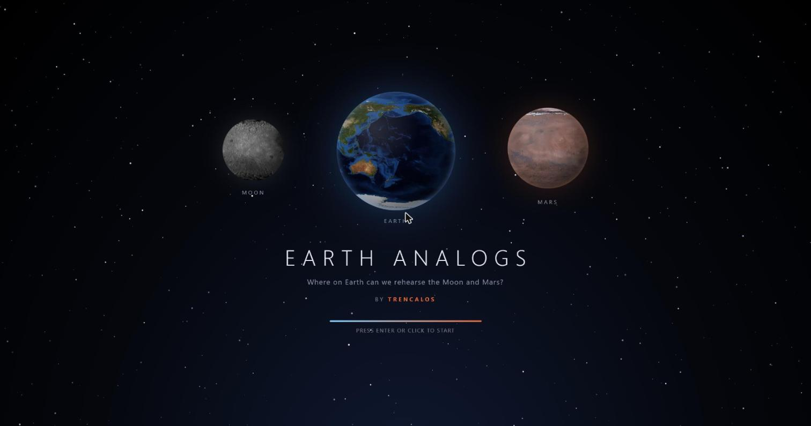
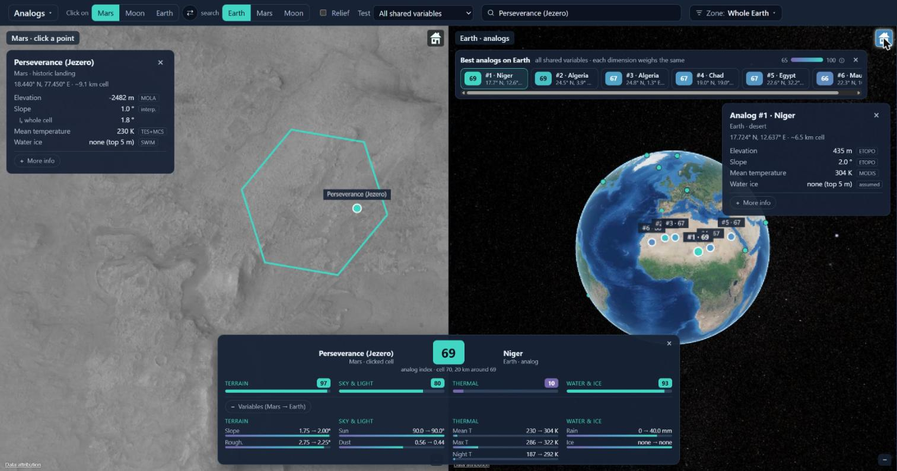
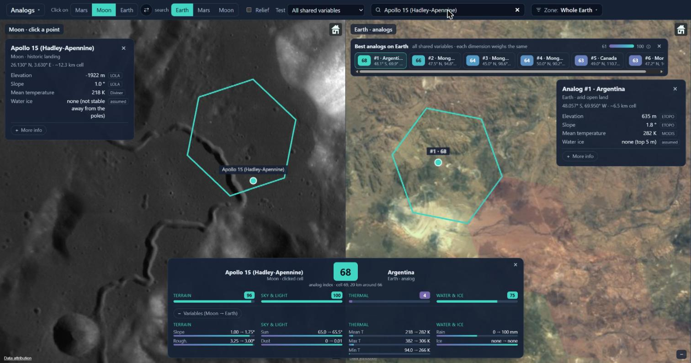
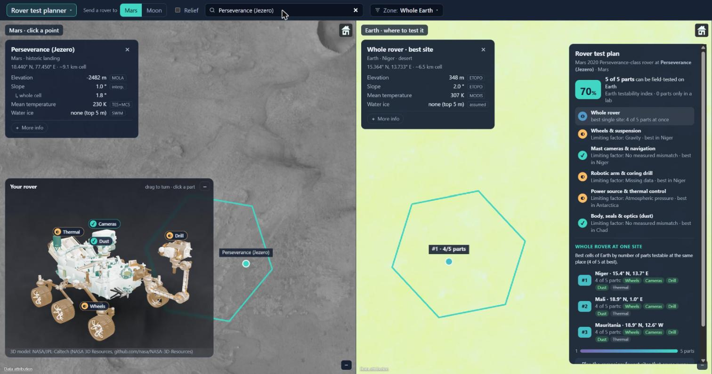
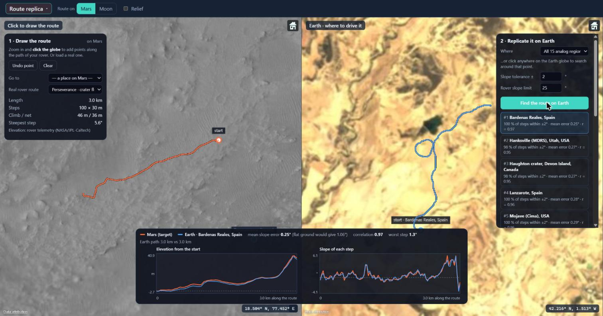

# User guide

How to install, start and use the app. No account, no server and no Python are needed: the app runs in
your browser from files that are already in the repository.

**Contents:** [1. Install and start](#1-install-and-start) · [2. The screen](#2-the-screen) ·
[3. Analogs view](#3-analogs-view) · [4. Rover test planner](#4-rover-test-planner) ·
[5. Route replica](#5-route-replica) · [6. Tips](#6-tips) · [7. Troubleshooting](#7-troubleshooting)

---

## 1. Install and start

### Requirements

| Program | Version | Download | Check it |
|---|---|---|---|
| Git | any | [git-scm.com/downloads](https://git-scm.com/downloads) | `git --version` |
| Node.js | 20 or newer (LTS) | [nodejs.org](https://nodejs.org) | `node --version` |
| A browser | recent Chrome, Edge or Firefox (WebGL 2) | — | — |

About 400 MB of disk (repository ~170 MB + libraries) and an internet connection for the map imagery.

### Steps

The same commands work in Windows PowerShell, macOS Terminal and Linux shells.

```bash
# 1. Download the project (once)
git clone https://github.com/pablourioste/SpaceAppsNASA.git
cd SpaceAppsNASA/app

# 2. Install the libraries (once, and again after every git pull)
npm install

# 3. Start the app
npm run dev
```

Open the address the terminal prints, normally **<http://localhost:5173>**. To stop it, press
`Ctrl + C` in the terminal. Next time, only `cd SpaceAppsNASA/app` and `npm run dev`.

Without Git: on the GitHub page, **Code → Download ZIP**, unzip it and open a terminal in its `app`
folder, then run steps 2 and 3.

### Optional: a static copy

```bash
npm run build      # writes the site to app/dist/
npm run preview    # serves app/dist/ at http://localhost:4173
```

`app/dist/` can be copied to any static web server.

---

## 2. The screen



Press **Enter** (or click) on the opening screen. The app shows two globes side by side:

| Area | What it is |
|---|---|
| Left globe | The body you **click on** |
| Right globe | The body where analogs are **searched** |
| Toolbar, left to right | View menu (title) · **Click on** Mars / Moon / Earth · **⇄** swap the globes · **search** Earth / Mars / Moon · **Relief** shaded relief on/off · **Test** what you want to test · place search box · **Zone** limit the search to a region |
| 🏠 on each globe | Back to the whole-globe view |
| Data attribution (bottom left of each globe) | Credits of the imagery |

Mouse: drag to rotate, wheel to zoom, right-drag or Ctrl-drag to tilt. `Esc` clears the selection.

---

## 3. Analogs view



1. Choose the bodies: e.g. **Click on: Mars**, **search: Earth**.
2. Click any point of the left globe, or type a site in the search box (`Jezero`, `Apollo 15`,
   `Shackleton`) or coordinates (`18.4, 77.5` or `18.4N 77.5E`) and press Enter.
3. The app then:
   - outlines the H3 cell you picked and opens its **card** (top left): elevation, slope, temperature,
     ice… each with its source tag (MOLA, TES, SWIM…). **More info** shows every variable;
   - scores every cell of the other body and paints the best ones (turquoise = most similar);
   - lists the **six best sites** at the top of the right globe (index and country), spread over the
     globe. Click one to fly there;
   - opens the card of analog #1 and the **score dock** (bottom): the analog index (0–100), the bar of
     each dimension (Terrain, Sky & light, Thermal, Water & ice) and, under **Variables**, both values of
     every compared variable with its note.
4. Change **Test** to weigh what matters for your test (Wheels, Navigation, Ice detection, Solar power
   and thermal control, Dust…). The ranking is recomputed; the results bar says how many of the test's
   variables could be compared.
5. **Zone** limits the search to a region (USA, North Africa, Antarctica…) or a box you draw.
6. **⇄** swaps the globes: the analog becomes the clicked point, so you can search back.

How to read the index: 100 = identical on every compared variable; a note of 0.5 on a variable means
the difference equals its tolerance. It is an analogy index, not a probability. Details:
[`METHODOLOGY.md`](METHODOLOGY.md).



*Apollo 15 (Hadley–Apennine, Moon) → the best Earth analogs are cold arid open land in Patagonia
(Argentina, index 68), then Mongolia and Canada. The thermal bar is low (4): no place on Earth has the
lunar day–night range.*

---

## 4. Rover test planner



Open it from the view menu (the title at the top left) or with `#rover` at the end of the address.

1. Choose **Send a rover to: Mars** or **Moon** and click a point (or search a site).
2. The panel on the right gives the **Earth testability index** and, for each part of the rover
   (wheels, cameras, drill, thermal control, dust), whether it can be tested **in the field** (✔),
   **with caveats** (◐) or **only in a lab** (✖), with the limiting factor (gravity, vacuum, missing data
   or the variable furthest from the target).
3. Click a part on the 3D rover or in the list to paint the Earth cells where that part can be tested.
   **Whole rover** shows the cells where most parts pass at once; **Plan the campaign** finds the fewest
   sites that together cover every part.

Margins and physics caps are in `app/data/rover.json` (assumptions; edit and reload).

---

## 5. Route replica



Open it from the view menu.

1. Draw a route on Mars or the Moon by clicking points along it, or pick a **Real rover route**
   (Perseverance or Curiosity traverses).
2. Set the **slope tolerance** and the **rover slope limit**, choose **Where** to search (all the
   analog regions or one), and press **Find the route on Earth**.
3. The app lists the Earth places where a path with the same slopes in the same order exists, draws the
   best one, and plots both elevation and slope profiles with the mean error and the correlation.

The search reads elevation live from public servers, so it takes from a few seconds to about a minute.

---

## 6. Tips

- The first search on a body downloads its search table once (Earth 3.5 MB); later searches take
  ~0.1–0.6 s.
- Zoom in on Mars to see the CTX mosaic (~5 m/px) and on Earth to see Sentinel-2 (~10 m/px).
- On Mars the card's **Slope** row also shows the slope of the ~0.9 km pixel under the click.
- Changing a tolerance or a test weight needs Python: edit `configs/*.yaml`, run
  `python scripts/export_scoring.py` and reload the page.

## 7. Troubleshooting

| Problem | Fix |
|---|---|
| `npm` or `node` "not recognized" | Close the terminal and open a new one; if it persists, reinstall Node.js |
| A red error about a missing import (`d3-geo`, `three`…) | Run `npm install` again |
| Port 5173 is busy | Use the address the terminal prints instead (5174, 5175…) |
| The globes stay black or grey | The imagery needs internet; reload the page |
| Very slow or the page freezes | Close other heavy tabs; the app needs WebGL and ~1 GB of memory |
